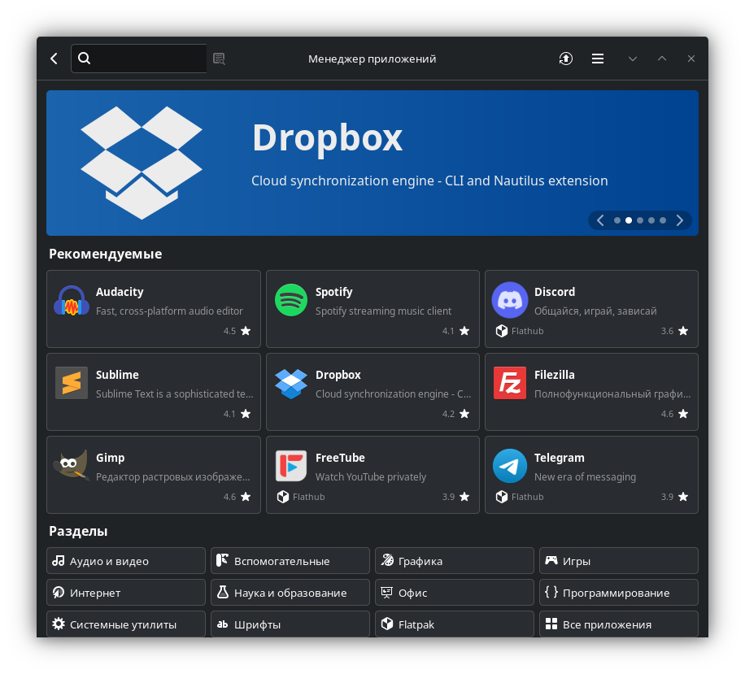

# Mintinstall

Fork of the Linux Mint Software Manager (Mintinstall) application, adapted for the **B1ackOS** distribution.



## B1ackOS fork

This is a fork of the original Linux Mint application: https://github.com/linuxmint/mintinstall

Changes compared to upstream (see `debian/changelog`):

* Added updates support
* Added AppStream support
* Added file installation support
* Added repository and key management support
* Added another source of preview photos

## Build
Get source code
```
git clone https://github.com/b1-ack/mintinstallpp
cd mintinstallpp
```
Build
```
dpkg-buildpackage --no-sign
```
Install
```
cd ..
sudo dpkg -i mintinstallpp*.deb
```

## Translations
Please use Launchpad to translate Mintinstall: https://translations.launchpad.net/linuxmint/latest/.

The PO files in this project are imported from there.
